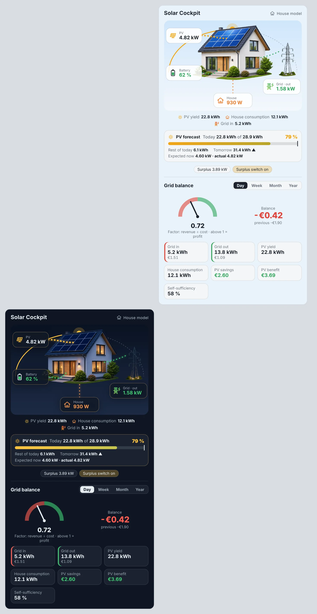
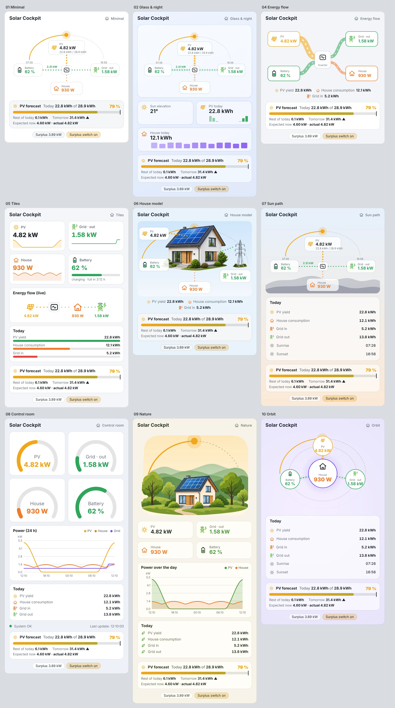
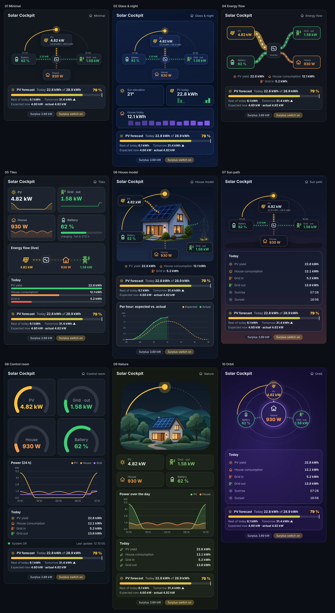

# Solar Cockpit

PV, battery, grid and cost overview for Home Assistant – one integration with its own energy-flow card.

Solar Cockpit does not talk to any device. It reads entities of integrations you already have (for example your **inverter** integration, **Forecast.Solar** and an **optical reader on the billing meter**) and calculates everything you would otherwise build from a dozen template helpers and utility meters.



## The card

`custom:solar-cockpit-card` comes with the integration – no resource to add. It has **nine styles**, each in a **light and a dark** version, and speaks **English and German**.

| Light | Dark |
| --- | --- |
|  |  |

Styles: `minimal`, `glass`, `flow`, `tiles`, `house`, `sunpath`, `control`, `nature`, `orbit`.

What every style shows:

- **PV, battery, grid and house** with live energy flows. Battery charging is green, discharging red. Grid *out* (selling) is green, *in* (buying) red. A connection without flow is a grey dashed line that stands still.
- **The sun on its daily arc** from sunrise to sunset (`sun.sun`), with the part of the day already covered.
- **PV forecast** (when Forecast.Solar or another forecast is configured): today's yield against the forecast, percentage reached, rest of today, tomorrow and expected vs. actual power. The house model style adds a per-hour chart of expected vs. actual PV.
- **Grid balance** for day / week / month / year: balance in €, factor (revenue ÷ cost), grid in and out, PV yield, consumption, PV savings, PV benefit and self-sufficiency.

The house model and nature styles use pictures that switch to a night version after sunset or in dark mode. Tiles, control room, nature and glass read the last 24 hours from the recorder for their charts.

Everything is set in the dashboard editor (dropdowns) or in YAML:

```yaml
type: custom:solar-cockpit-card
# all optional:
style: house               # minimal | glass | flow | tiles | house | sunpath | control | nature | orbit
mode: auto                 # auto (follows the HA theme) | light | dark
language: auto             # auto | en | de
show_costs: true
default_period: day        # day | week | month | year
peak_power: 10000          # W, scales gauges and flow widths
title: Solar Cockpit
details:                   # extra values, e.g. temperatures
  - sensor.inverter_temperature
```

## Sensors

**Live** (signs are normalised: grid + = buying, battery + = charging)
PV power, house consumption, grid power / import / export, battery power / charging / discharging, PV surplus, self-sufficiency and self-consumption right now, battery energy available / to full / time remaining / state, effective import price and feed-in tariff.

**Price settings** `number.solar_cockpit_price_buy` and `number.solar_cockpit_price_sell` (€/kWh) – change them on the device page or a dashboard. For a dynamic tariff, set a price entity in the options instead; it then takes precedence.

**Per period: day · week · month · year**
Import, export, PV yield, self-consumed, consumption, self-sufficiency, import cost, feed-in revenue, **grid balance**, **grid balance factor**, **PV savings** (self-consumed PV × import price), **PV benefit** (savings + revenue) and forecast achievement (today). Every period sensor has a `previous_value` attribute that holds the value of the previous period.

- Money is calculated with the **price that applied when the energy flowed**, so a dynamic tariff (a sensor in ct/kWh or €/kWh) works as it is.
- On first setup, the running week, month and year are filled in from the long-term statistics.
- Glitches from meter readers (a short `0` after reconnecting, implausible jumps) are ignored.

**Binary sensor "PV surplus available"** with on and off thresholds and a minimum battery SOC. Use it to trigger an air conditioner, a heating rod and similar loads.

## Installation

### HACS
1. HACS → ⋮ → *Custom repositories* → `https://github.com/itfhunter/solar_cockpit`, type **Integration**.
2. Install "Solar Cockpit" and restart Home Assistant.
3. *Settings → Devices & services → Add integration → Solar Cockpit*.

### Manual
Copy `custom_components/solar_cockpit` to `/config/custom_components/` and restart.

## Setup

The dialog has sections. Only **PV power** is required; everything else is optional and unlocks more sensors.

| Section | What to pick |
| --- | --- |
| PV | Total PV power (W/kW), optionally the power of each string, and the PV energy counter (kWh) |
| Battery | State of charge, battery power, optional charge/discharge counters, usable capacity and the discharge limit |
| House & grid | House consumption and grid power from the inverter (house consumption can be left empty: PV + grid − battery) |
| Utility meter | Import and export counters of the billing meter (1.8.0 / 2.8.0) – the basis for all € values |
| Forecast | Forecast today, rest of today, tomorrow and power now (e.g. Forecast.Solar) |
| Prices | Start values for the price settings, or a price entity for a dynamic tariff |
| Surplus | Thresholds and minimum SOC for the surplus switch |

**Signs:** Solar Cockpit works with grid + = buying and battery + = charging. If your inverter reports it the other way round, switch on "Invert sign" for grid or battery.

You can change everything later under *Configure*.

## Replacing old helpers

If you built this with template helpers and utility meters before, let Solar Cockpit run alongside them and delete the old helpers once the values match. Static `input_number` price helpers that were configured as price entity in an earlier version are taken over into the price settings automatically.

## Changelog

**0.4.0**
- House model: the house sits lower so the sun's arc stays visible; the scene keeps a sensible size on wide dashboards.
- House model: per-hour chart of expected vs. actual PV (forecast from any integration that feeds the Energy dashboard's solar forecast, e.g. Forecast.Solar).

**0.3.1** – Neutral defaults: no pre-filled entity ids, generic start values for prices and battery capacity.

**0.3.0**
- Nine card styles with light and dark versions, English and German.
- PV forecast block in every style; sun on its daily arc.
- Prices are settings of the integration (`number.solar_cockpit_price_buy` / `_sell`); existing `input_number` price helpers are taken over automatically.
- Grid wording *in* / *out*; idle flows grey and still.
- Sub-meter option removed – the house always shows total consumption.

**0.2.1** – Running week / month / year are filled correctly from statistics when the sensors are younger than the period.

**0.2.0** – First public version.

## Service

`solar_cockpit.reset_period` resets day, week, month or year to 0.

## Development

```bash
pip install pytest-homeassistant-custom-component
pytest
```

License: MIT
